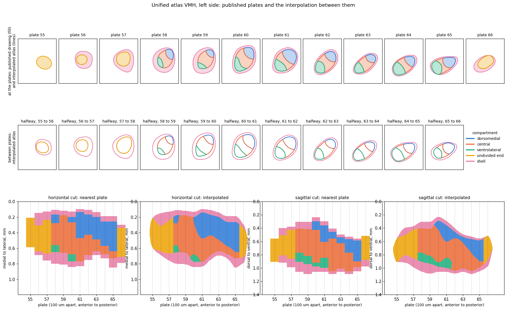
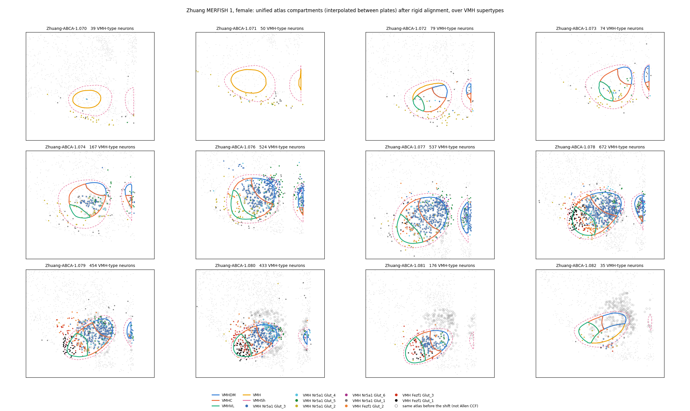
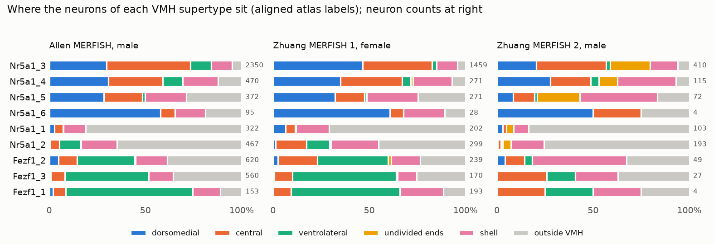
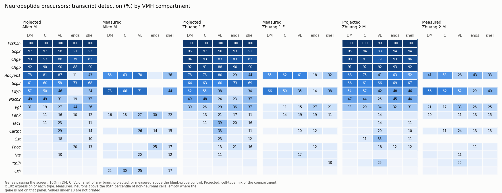
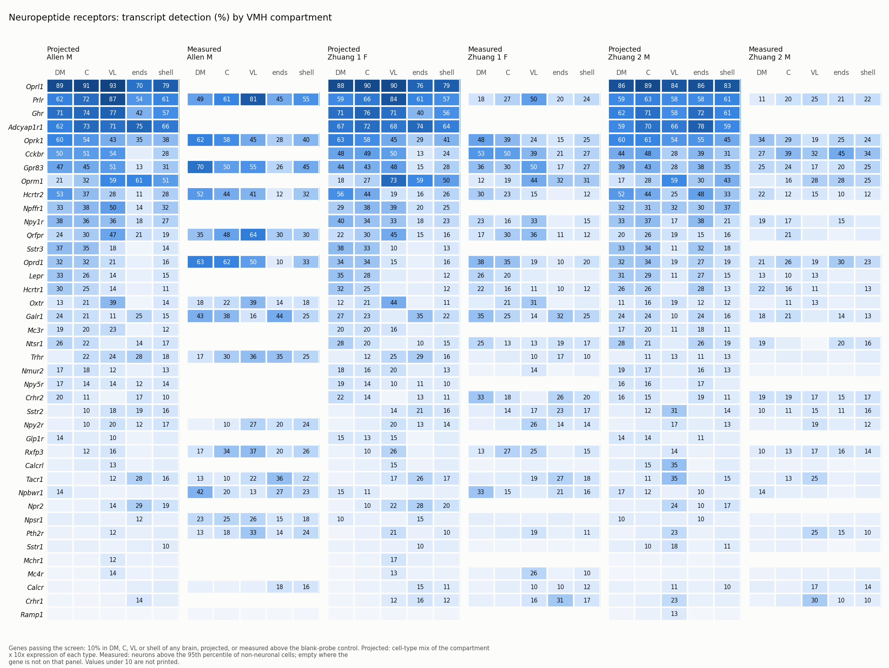
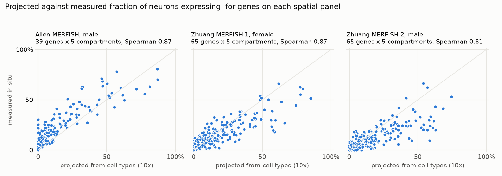

# A neuropeptide atlas of the mouse ventromedial hypothalamus

20 November 2026 · Charles Xu

*Repository copy of the written report. It describes the pipeline and results at commit `655bd0b`; the tables in `results/tables` and the explorer are the source of the numbers.*

## Summary

Neurons of the ventromedial hypothalamic nucleus (VMH) make few neuropeptides and carry many receptors: 18 of 89 precursor genes and 40 of 98 receptor genes pass the screen, which asks for 10% of the neurons of a compartment in at least one of three brains.

- **Peptides made.** *Adcyap1* (PACAP) is expressed by 79 to 87% of neurons in the dorsomedial, central and ventrolateral compartments, and *Pdyn* by about half. The ventrolateral compartment adds *Tac1* (23%), *Cartpt* (29%) and *Sst* (17%), each at 6% or less dorsomedially.
- **Receptors carried.** *Oprl1*, *Adcyap1r1*, *Ghr* and *Cckbr* are broad. *Lepr*, *Crhr2*, *Hcrtr1*, *Hcrtr2*, *Sstr3*, *Ntsr1* and *Galr1* lean dorsomedial. *Oxtr* (39% against 13%), *Oprm1*, *Mc4r*, *Npy2r*, *Prlr* and *Qrfpr* lean ventrolateral.
- **Where the ligands come from.** Of the 40 receptors, 14 have a cognate peptide made inside VMH, 16 depend on regions with a cited projection to VMH (4 of them also on a hormone), 4 are endocrine only (*Prlr*, *Ghr*, *Lepr*, *Glp1r*), 3 work only through a partner subunit (*Calcr*, *Calcrl*, *Ramp1*) and 3 have no source among the counted regions (*Nmur2*, *Rxfp3*, *Pth2r*).
- **How far to trust it.** Estimates projected from cell types track direct in situ measurements (Spearman 0.82 to 0.88 across genes and compartments). Four calls sit within one percentage point of the threshold (*Gal*, *Nts*, *Cckar*, *Npr3*), and *Crh* and *Gal* are listed on a measured value alone. No sex difference survives correction, and that test is weak.

All of this is transcript evidence. It shows which peptides and receptors VMH neurons can make, not that a peptide is released or that a receptor sits on the soma.

Any gene can be looked up in the [VMH neuropeptide atlas explorer](https://charlesxu-jingyue.github.io/VMH_NP/): a map of neurons in each brain, expression by compartment and supertype, and ligand sources.

## Data and method

The atlas combines one sequencing dataset, which says what each cell type expresses, with three spatial brains, which say where each cell type sits. All are from the Allen Brain Cell Atlas, release 20250531.

| Dataset | Content | Role |
| --- | --- | --- |
| 10x single-cell RNA sequencing, hypothalamus | 262,175 cells (162,296 v3 chemistry, 99,879 v2) from 14 female and 13 male donors; 10,338 cells of the nine VMH supertypes | Expression of every gene in every cell type |
| Allen spatial brain, male | Multiplexed error-robust fluorescence in situ hybridization (MERFISH), 550 genes; 3,849 neurons in the VMH core and 1,575 in the shell | Cell positions; direct measurement of 17 precursors and 22 receptors; 50 blank probes as a noise control |
| Zhuang spatial brain 1, female | MERFISH, 1,122 genes; 2,574 core and 1,032 shell neurons | Cell positions; direct measurement of 19 precursors and 46 receptors; no blank probes |
| Zhuang spatial brain 2, male | Same panel; 626 core and 287 shell neurons | Replication, thinly sampled |
| Unified atlas, Chon et al. 2019 | Franklin and Paxinos labels in the Allen Common Coordinate Framework (CCF), as coronal plates 100 µm apart | Compartments: dorsomedial, central, ventrolateral, undivided ends, shell |

**Gene set.** 89 peptide precursor genes, 98 receptor or receptor-component genes and 159 ligand-receptor pairings, curated by hand. Endocrine ligands and granins are included and tagged.

**Which cells count as VMH.** A neuron belongs to the compartment whose atlas label covers its position, after two corrections. The atlas itself sits exactly in the Allen CCF: its plates are drawn on template images that are identical, pixel for pixel, to every tenth coronal plane of the Allen template.

**Interpolation between plates.** The atlas plates were each drawn separately, and the tissue sections are not parallel to them: within one section the VMH spans 50 to 220 µm along the anterior-posterior axis. Reading the nearest plate would stitch two or three drawings together in one section, with seams. The compartments are therefore interpolated between plates. Each plate's outlines are converted to signed distance fields, smoothed in the plane with a 15 µm Gaussian, and joined across plates by a monotone cubic. Smoothing can move a boundary by a pixel or two at a published plate, and between plates the atlas never leaves the range of the two neighbours. Against a nearest-plate reading it changes the label of 11 to 15% of the neurons in or next to VMH, nearly all at compartment borders or the outer edge. The nearest-plate labels are kept alongside.

Top: at each plate, the interpolated atlas (lines) over the published drawing (fill). Middle: the interpolated atlas halfway between plates. Bottom: horizontal and sagittal cuts through the nucleus, read from the nearest plate and from the interpolated atlas. The two vertical seams that remain are where the undivided end plates give way to the divided ones.

**Alignment.** Read at the released coordinates, the labels are offset from the VMH cell types by 0.1 to 0.4 mm along the anterior-posterior axis, so each brain is aligned by one rigid shift. The shift maximises overlap between neurons of the two VMH subclasses and the atlas VMH as a whole; compartment identity plays no part in the fit.

| Brain | Shift, anterior-posterior | Core neurons that are VMH types, raw | Aligned |
| --- | --- | --- | --- |
| Allen, male | 0.30 mm | 53% | 87% |
| Zhuang 1, female | 0.40 mm | 66% | 82% |
| Zhuang 2, male | 0.10 mm | 77% | 77% |

"Core" pools the dorsomedial, central and ventrolateral compartments with the undivided ends of the nucleus. The shell is reported on its own, since only about half of its neurons are VMH types. The undivided ends are reported but do not decide whether a gene is listed: after alignment only 3% (Allen), 6% (Zhuang 1) and 78% (Zhuang 2) of the neurons inside them are VMH types.

Aligned, interpolated compartments (outlines) over neurons of the nine VMH supertypes in the female brain, anterior to posterior. Grey rings mark neurons that the same unified atlas places in VMH before the shift, at the released coordinates. They are not the Allen CCF boundary.

The Fezf1_1 and Fezf1_3 supertypes concentrate in the ventrolateral compartment and Nr5a1_3 to Nr5a1_6 in the dorsomedial and central compartments, although compartments played no part in the alignment.

**The unified atlas against the Allen CCF annotation.** The unified atlas is used here for its compartments, which the Allen annotation lacks, and not because its outer boundary fits the cell types better. Both atlases are drawn in the same CCF space. The Allen VMH and the unified core have the same volume (0.55 mm³) but overlap with a Dice coefficient of only 0.71, and the unified core is centred 133 µm further posterior. When each outline is given its own best rigid shift, the Allen VMH agrees with the two VMH subclasses at least as well in every brain:

| Brain | Outline | F1 at released coordinates | F1 after its own best shift | Neurons inside that are VMH types, after shift |
| --- | --- | --- | --- | --- |
| Allen, male | Allen CCF VMH | 0.68 | 0.79 | 92% |
|  | Unified core | 0.48 | 0.72 | 84% |
|  | Unified core and shell | 0.58 | 0.75 | 73% |
| Zhuang 1, female | Allen CCF VMH | 0.62 | 0.81 | 86% |
|  | Unified core | 0.50 | 0.74 | 82% |
|  | Unified core and shell | 0.65 | 0.76 | 72% |
| Zhuang 2, male | Allen CCF VMH | 0.70 | 0.72 | 86% |
|  | Unified core | 0.57 | 0.62 | 76% |
|  | Unified core and shell | 0.68 | 0.71 | 73% |

F1 combines the share of neurons inside the outline that are VMH types with the share of VMH-type neurons that fall inside it. The Allen VMH needs about half the anterior-posterior shift that the unified atlas needs (0.15, 0.25 and 0.05 mm), so the offset corrected by the alignment is partly cell registration and partly the position of the unified atlas drawing. The anatomical names in the cell-type taxonomy were assigned partly from where cells fall in Allen CCF space, so this test is not fully independent of the Allen annotation.

**Calling expression.** Abundant hypothalamic peptide transcripts leak into every droplet, so a nonzero count is not evidence of expression. For each gene and library, the background is the lowest mean among non-neuronal cell classes. A cell type is called expressing when at least 10% of its cells exceed what that background predicts and its mean is at least 3 times the background. Sparse calls must also be at least twice the typical neuronal type.

**Two estimates per compartment.**

- *Projected*: the compartment's mix of cell types, from the spatial data, times each type's fraction of expressing cells, from the 10x data. Available for all genes.
- *Measured*: for genes on a spatial panel, the fraction of the compartment's neurons above the 95th percentile of non-neuronal cells in the same brain.

**The screen.** A gene is listed when, in the dorsomedial, central, ventrolateral or shell compartment of at least one brain, its projected fraction reaches 10%, or its measured fraction does and also clears a control. The control comes from the 50 blank probes of the Allen panel, which target no transcript. Put through the measured rule, a blank probe passes in a median of 6 to 7% of a compartment's neurons, and the 95th percentile across blank probes is 16 to 20%. A measured value counts on its own only above that percentile. The Zhuang panels carry no blank probes, so a measured value there confirms a projection but does not list a gene by itself.

## Part 1: peptides made by VMH neurons

Eighteen precursor genes pass the screen: seven granin-type genes found in most neurons, seven classical neuropeptides with a clear spatial pattern, and four that pass on thinner evidence (*Nts*, *Gal*, *Pthlh*, *Crh*).

### By compartment

Percent of neurons expressing, projected from the male brain's cell-type mix. The female brain's mix gives the same ordering.

| Precursor | Peptide | Dorsomedial | Central | Ventrolateral | Shell |
| --- | --- | --- | --- | --- | --- |
| *Adcyap1* | PACAP | 79 | 82 | 87 | 43 |
| *Pdyn* | dynorphins | 58 | 50 | 46 | 34 |
| *Cartpt* | CART | 3 | 5 | 29 | 13 |
| *Tac1* | substance P, neurokinin A | 4 | 10 | 23 | 11 |
| *Sst* | somatostatin | 6 | 3 | 17 | 10 |
| *Penk* | enkephalins | 9 | 11 | 16 | 12 |
| *Pnoc* | nociceptin | 4 | 3 | 8 | 13 |

- **Two peptides are nucleus-wide.** *Adcyap1* and *Pdyn* are made across all three core compartments and thin out in the shell.
- **The ventrolateral compartment has its own set.** *Cartpt*, *Tac1* and *Sst* rise several-fold from dorsomedial to ventrolateral. In situ measurement agrees where the panel allows: *Cartpt* is 8, 7 and 27% in the male Allen brain.
- **Granins are near-universal.** *Pcsk1n*, *Scg2*, *Chga* and *Chgb* are in 83% of neurons or more everywhere; *Scg3*, *Nucb2* and *Vgf* in 19 to 67%.
- **Four pass on thinner evidence.** *Nts* and *Gal* are borderline: each is measured in 20% of ventrolateral neurons in the Allen brain, less than half a point above the blank-probe control, and *Nts* is also projected at 11% in Zhuang 1. *Pthlh* rests on the ventrolateral compartment of Zhuang 2 alone (projected 25%, 53 neurons). *Crh* is measured in 22 to 30% of core neurons in the Allen brain, with a projection of zero and at most 2% measured in the Zhuang brains. Treat *Crh* and *Gal*, which have no projection of 10% anywhere, as leads to confirm.
- **The famous hypothalamic peptides are not made here.** *Pomc*, *Agrp*, *Pmch*, *Hcrt*, *Oxt* and *Avp* are each at or below about 1% in the core once background is removed. Raw detection of *Pomc* and *Agrp* was near 20%, all of it at background level.

All 18 listed precursors, projected and measured in each of the three brains. The undivided ends are shown beside the four screened compartments.

### By supertype

Nineteen precursors are expressed in at least one of the nine VMH supertypes. Percent of cells expressing beyond background, 10x v3 chemistry:

| Precursor | Fezf1_1 | Fezf1_3 | Fezf1_2 | Nr5a1_3 | Nr5a1_4 | Nr5a1_5 | Nr5a1_6 | Nr5a1_2 | Nr5a1_1 |
| --- | --- | --- | --- | --- | --- | --- | --- | --- | --- |
| *Adcyap1* | 97 | 97 | 83 | 91 | 90 | 21 | 69 | 89 | 24 |
| *Pdyn* | 22 | 35 | 63 | 66 | 48 | 60 | 60 | 47 | background |
| *Tac1* | 75 | 55 | background | background | background | 13 | background | 47 | background |
| *Cartpt* | 64 | 48 | 17 | background | background | background | background | background | background |
| *Sst* | 26 | 48 | background | background | background | background | 67 | background | background |
| *Penk* | 30 | 27 | 23 | background | 20 | 22 | background | background | background |

The two Esr1-rich supertypes, Fezf1_1 and Fezf1_3, carry *Tac1*, *Cartpt* and *Sst* together. Nr5a1_6, a small dorsomedial supertype, is the other *Sst* source. Nr5a1_1 and Nr5a1_2 lie mostly outside the atlas VMH (46 to 82% of their neurons in the two well-sampled brains), so their peptides, including *Tac1* in Nr5a1_2, belong to the tuberal surround more than to the nucleus.

## Part 2: receptors on VMH neurons

Forty receptor genes pass the screen, and most sort into a broad set, a dorsomedial-leaning set and a ventrolateral-leaning set. *Cckar* and *Npr3* miss by less than one percentage point.

### By compartment

Percent of neurons expressing, projected from the male brain's cell-type mix; principal G-protein coupling in the second column is from general pharmacology and unchecked against a reference.

| Receptor | Coupling | Dorsomedial | Central | Ventrolateral | Shell |
| --- | --- | --- | --- | --- | --- |
| **Broad** |  |  |  |  |  |
| *Oprl1* | Gi/o | 89 | 91 | 93 | 79 |
| *Adcyap1r1* | Gs (also Gq) | 62 | 73 | 71 | 66 |
| *Ghr* | JAK-STAT | 71 | 74 | 77 | 57 |
| *Cckbr* | Gq | 50 | 51 | 54 | 28 |
| *Npy1r* | Gi/o | 38 | 36 | 36 | 27 |
| **Dorsomedial-leaning** |  |  |  |  |  |
| *Hcrtr2* | Gq | 53 | 37 | 28 | 28 |
| *Sstr3* | Gi/o | 37 | 35 | 18 | 14 |
| *Lepr* | JAK-STAT | 33 | 26 | 14 | 15 |
| *Hcrtr1* | Gq | 30 | 25 | 14 | 11 |
| *Ntsr1* | Gq | 26 | 22 | 9 | 17 |
| *Galr1* | Gi/o | 24 | 21 | 11 | 15 |
| *Crhr2* | Gs | 20 | 11 | 3 | 10 |
| **Ventrolateral-leaning** |  |  |  |  |  |
| *Prlr* | JAK-STAT | 62 | 72 | 87 | 61 |
| *Oprm1* | Gi/o | 21 | 32 | 59 | 51 |
| *Qrfpr* | Gq | 24 | 30 | 47 | 19 |
| *Oxtr* | Gq (also Gi/o) | 13 | 21 | 39 | 14 |
| *Npy2r* | Gi/o | 5 | 10 | 20 | 17 |
| *Mc4r* | Gs | 1 | 2 | 14 | 5 |

- **The gradients replicate.** The female brain's cell-type mix gives the same direction for every receptor in the two leaning sets.
- **In situ measurement agrees.** In the female brain, measured *Crhr2* is 33, 18 and 5% from dorsomedial to ventrolateral, *Lepr* 26, 20 and 9%, *Mc4r* 4, 7 and 26%, and *Oxtr* 9, 21 and 31%.
- **Two receptors cannot be placed.** *Insr* and *Igf1r* are detected in most neurons, but no higher than in non-neuronal cells, so the test cannot separate expression from background.
- **The shell differs.** It keeps the opioid receptor *Oprm1* (51%) but has less *Cckbr* and *Hcrtr2* than the core.
- **Some listings are thin.** *Sstr1* and *Ramp1* are listed on the ventrolateral compartment of Zhuang 2 alone, which holds 53 neurons. Ten genes reach 10% only by a measured value that the control does not support and are left out: *Avpr1a*, *Agtr1a*, *Cckar*, *Grpr*, *Npr3*, *Rxfp1* and *Tacr3* among receptors, *Trh*, *Grp* and *Prok2* among precursors. *Npffr2* and *Tac2* reach 10% only in the undivided ends.

All 40 listed receptors, projected and measured in each of the three brains. The table above shows the 18 with the clearest pattern.

### By supertype

Forty-eight receptors are expressed in at least one VMH supertype, and only *Oprl1* and *Prlr* in all nine. The supertypes explain the compartment gradients:

- **Esr1-rich Fezf1_1 and Fezf1_3:** *Oxtr* (78 and 65%), *Oprm1* (89 and 87%), *Qrfpr* (85 and 58%), with *Npy2r* (60%) and *Npy1r* (85%) in Fezf1_3.
- **Nr5a1_3, the main dorsomedial and central supertype:** *Lepr* (44%), *Sstr3* (47%), *Hcrtr2* (59%), *Hcrtr1* (38%), *Crhr2* (21%).
- **Nr5a1_5 and Nr5a1_6, small dorsomedial supertypes:** the strongest *Crhr2* (42 and 51%); Nr5a1_6 also has *Lepr* (44%) and *Hcrtr2* in every cell.

Because 18 to 31% of Esr1-rich neurons fall outside every atlas compartment, the ventrolateral column understates what those supertypes carry. For questions about that population, read the supertype numbers.

## Part 3 (supplemental): peptides available in VMH, and whether they match the receptors

Most receptors in VMH have a plausible peptide source, and for most of them that source lies outside the nucleus: 14 of 40 receptors have a cognate peptide made by VMH neurons, while 20 depend on afferent regions or hormones alone.

Release itself cannot be read from these data. Three kinds of availability stand in for it:

- **Local:** VMH neurons make the peptide (Part 1). Eighteen precursor genes qualify.
- **Afferent:** neurons in a region with a cited projection to VMH make it. The repository lists 25 regions, each with an evidence type and a citation. The 18 backed by a mouse tracing citation count, and 48 precursor genes are made in at least one of them. Whether a cluster makes a peptide is decided by a classifier whose threshold was set on hypothalamic cluster-gene pairs (F1 0.87, the same when whole clusters are held out).
- **Endocrine:** the ligand is made mainly outside the brain. Twenty-two genes carry this tag.

| Source of a cognate peptide | Receptors in VMH | Peptide and where it is made |
| --- | --- | --- |
| Local, also afferent (14) | *Oprl1*, *Adcyap1r1*, *Oprk1*, *Oprm1*, *Oprd1*, *Sstr1*, *Sstr2*, *Sstr3*, *Tacr1*, *Gpr83*, *Ntsr1*, *Galr1*, *Crhr1*, *Crhr2* | *Pnoc*, *Adcyap1*, *Pdyn*, *Penk*, *Sst*, *Tac1*, *Pcsk1n*, *Nts*, *Gal*, *Crh*, all listed in VMH; the last three are the thin calls of Part 1 |
| Afferent only (12) | *Hcrtr1*, *Hcrtr2*, *Mchr1* | *Hcrt* and *Pmch*, lateral hypothalamic area |
|  | *Oxtr* | *Oxt* and *Avp*, paraventricular hypothalamic nucleus |
|  | *Mc3r*, *Mc4r* | *Pomc* and *Agrp*, arcuate nucleus |
|  | *Trhr*, *Npr2* | *Trh* and *Nppc*, each in 8 or more of the counted regions |
|  | *Qrfpr*, *Npffr1*, *Npbwr1*, *Npsr1* | *Qrfp*, tuberal nucleus; *Npvf*, dorsomedial nucleus; *Npb* and *Npw*, periaqueductal gray; *Nps*, parabrachial nucleus |
| Afferent and endocrine (4) | *Cckbr*, *Npy1r*, *Npy2r*, *Npy5r* | *Cck*, amygdala, subiculum and parabrachial nucleus; *Npy*, arcuate nucleus and amygdala; gastrin and peptide YY from the periphery |
| Endocrine only (4) | *Prlr*, *Ghr*, *Lepr*, *Glp1r* | prolactin, growth hormone, leptin; GLP-1 from the intestine, since *Gcg* has no source cluster in the brain here |
| Only through a partner (3) | *Calcr*, *Calcrl*, *Ramp1* | Receptors for CGRP, amylin and adrenomedullin form only when two of these subunits are in the same cell, which compartment fractions cannot show |
| No source among the counted regions (3) | *Nmur2*, *Rxfp3*, *Pth2r* | *Rln3* cells sit in the nucleus incertus and *Pth2* cells in the subparafascicular area, neither on the list; *Nmu* and *Nms* are made in no counted region |

**Agreement with Part 2.** The receptors with a local ligand are mostly broad or opioid. The receptors that distinguish compartments are mostly supplied from outside: *Lepr*, *Hcrtr1* and *Hcrtr2* in the dorsomedial set, and *Oxtr*, *Mc4r*, *Npy2r* and *Prlr* in the ventrolateral set, depend on afferent or endocrine ligands. *Crhr2*, *Galr1* and *Ntsr1* gain a local ligand only through *Crh*, *Gal* and *Nts*, the thinnest local calls. On this evidence the compartments differ more in what they listen to than in what they say.

**Peptides made in VMH with no receptor there.** *Cartpt*, whose receptor is unresolved, *Pthlh*, and the granins. These are candidates for signalling to VMH targets, not within it.

**Two checks against the literature**, from articles retrieved from PubMed. Lateral parabrachial cholecystokinin neurons target SF1 neurons of VMH ([Garfield et al. 2014](https://doi.org/10.1016/j.cmet.2014.11.006)); here *Cck* clusters make up 37% of parabrachial neurons and *Cckbr* is in about half of core neurons. Urocortin 3 neurons of the median preoptic nucleus and medial amygdala send fibres to VMH in the rat ([Li et al. 2002](https://doi.org/10.1523/JNEUROSCI.22-03-00991.2002)); here *Ucn3* clusters are found in those two regions and *Crhr2* is dorsomedial.

**What this does not show.** "Afferent" asks whether a region that projects to VMH contains neurons making the peptide, not whether those neurons are the ones that project. The spatial distribution of peptide release inside VMH is not available from transcript data. VMHvl receives input from over 30 regions ([Lo et al. 2019](https://doi.org/10.1073/pnas.1817503116)), so the 25-region list is incomplete by construction.

## Sex and replication

The compartment patterns replicate across brains and methods, and no sex difference in expression survives correction.

| Check | Result |
| --- | --- |
| Projected against measured in situ, gene by compartment | Spearman 0.88 (Allen male), 0.86 (Zhuang 1 female), 0.82 (Zhuang 2 male) |
| 10x v2 against v3 chemistry, supertype by gene | Spearman 0.85 over 1,881 pairs |
| Male against female cell-type mix | Same direction for every dorsomedial-leaning and ventrolateral-leaning receptor in Part 2 |
| Marker genes measured in the female brain | *Esr1* 7, 9 and 35% and *Nr5a1* 87, 78 and 22%, dorsomedial to ventrolateral |
| Female against male 10x libraries | 307 supertype-by-gene tests in 7 supertypes (exact permutation rank-sum test across donors); none below a false discovery rate of 0.05 (lowest 0.65) |

- **The sex test is weak.** It compares 3 to 5 female donors with 3 to 7 male donors, so only large differences could pass. The largest nominal one is *Ghr* in Nr5a1_5, 90% of male cells against 64% of female (p = 0.004).
- **Measured levels are platform-specific.** *Prlr* in the ventrolateral compartment reads 81% in the Allen brain and 50% in Zhuang 1. The rank order across compartments holds, but a male-female difference cannot be read off two platforms.
- **Zhuang 2 adds little.** It has 53 ventrolateral neurons and 31 neurons of the Esr1-rich supertypes, and its alignment does not improve agreement with the cell types (77% before and after).

## Limits and open items

The main limits are that transcripts stand in for peptides and receptors, and that atlas compartments stand in for the molecular territories.

- **Transcript, not protein.** A precursor needs processing before it yields a peptide, one precursor can yield several, and a receptor's protein may be trafficked to terminals outside VMH.
- **Sparse receptors are under-counted.** Droplet sequencing misses low-abundance transcripts, so receptor percentages are lower bounds. Calls below 20% are the least secure.
- **A threshold makes a sharp list out of graded data.** *Gal* and *Nts* are listed with less than one percentage point to spare, and *Cckar* and *Npr3* miss by as little. Correcting the position of the atlas by 10 µm moved *Gal* onto the list and *Cckar* off it.
- **The measured control is a 95th percentile, and only one brain has it.** One blank probe in twenty exceeds it, so among the 39 genes measured in the Allen brain a few would pass by chance; *Crh* and *Gal* are listed on a measured value alone. The Zhuang brains have no blank probes, so a genuine low-abundance receptor measured only there is not listed.
- **The atlas ventrolateral compartment is narrower than the Esr1-rich territory.** About half of Esr1-rich neurons fall inside it after alignment, and 18 to 31% fall outside every compartment.
- **Alignment is a rigid shift, and the atlas between plates is interpolated.** The shift corrects the offset but not local distortion, and the shell collects neighbours: only about half of its neurons are VMH types. A residual rotation was tested and is small or not determined by 5 to 12 coronal sections. Positions between the 100 µm plates follow an interpolation of the published drawings, not a published label; against a nearest-plate reading, about one neuron in eight changes compartment, mostly at borders.
- **The atlas VMH is longer than the molecular VMH.** In two brains its undivided ends, mostly the anterior one, hold neurons of anterior hypothalamic types and almost none of the VMH subclasses. The likeliest reading is that the atlas includes, as undivided VMH, tissue that the molecular labels do not resolve as VMH. The ends are therefore reported but kept out of the screen.
- **Developmental names are not locations.** Nr5a1_1 and Nr5a1_2 carry VMH names but sit mostly outside the nucleus.
- **Part 3 is not projection-specific.** Each afferent region now carries an evidence type and a citation, and only regions with a mouse tracing citation count. Several of those cite Lo et al. 2019 for regions that could not be confirmed in the main text of that paper and may appear only in its Fig. 1L or Table S3. Projection data from the Allen Mouse Brain Connectivity Atlas, including its peptide-Cre injections, would test the list directly; that interface was unreachable from this workspace.
- **Unchecked inputs.** The G-protein coupling column, and the atlas structure names, which came from a third-party copy of the BrainGlobe table.

Open items:

- [ ] Check the afferent regions cited to Lo et al. 2019 against its Fig. 1L and Table S3, and find citations for the five regions in `config/vmh_afferent_regions.csv` that have none
- [ ] Confirm *Crh* and *Gal* in VMH by an independent method
- [ ] Check receptor coupling against the IUPHAR/BPS Guide to Pharmacology
- [ ] Add projection evidence from the connectivity atlas for peptide-Cre lines
- [ ] Decide whether the imputed spatial tier (50 GB) is worth adding for per-cell maps of unmeasured genes

## Files and how to reproduce

Everything is in the `VMH_NP` repository; each numbered script reads the outputs of the ones before it.

| Step | Script | Output |
| --- | --- | --- |
| 0 | `00_download_data.py` | Pinned Allen files in the data folder, checksums verified |
| 1 | `01_extract.py` | VMH-centred windows of the three spatial brains; curated genes for all hypothalamus 10x cells |
| 2 | `02_expression.py` | expr_by_type.parquet: every gene by subclass, supertype and cluster, with calls |
| 3 | `03_reference_atlas.py` | Atlas labels per cell, raw and aligned; atlas_alignment.csv. With `--verify-ap` it checks the plate position against the Allen template |
| 4 | `04_atlas_figure.py` | Figures of the interpolated atlas and of each brain's alignment |
| 5 | `05_vmh_type_summary.py` | vmh_supertype_calls.csv |
| 6 | `06_compartments.py` | gene_by_compartment.csv, gene_by_ap.csv, blank_probe_floor.csv, sex_differences.csv |
| 7 | `07_arriving_peptides.py` | ligand_sources.csv, receptor_ligand_concordance.csv, ligand_by_region.csv, ligand_calibration.csv |
| 8 | `08_figures.py` | Report figures |
| 9 | `09_build_explorer.py` | The explorer page, in docs |

Two further steps follow the table: `10_atlas_comparison.py` compares the unified atlas with the Allen CCF annotation, and `11_build_docs.py` builds the documentation page of the web site. Tables are in `results/tables`, figures in `results/figures`, and the static web site (explorer and documentation) in `docs`. The gene lists and the afferent region list are plain files in `config` and can be edited before re-running from step 2 or step 7. The checks in the tests folder cover the screen, the explorer data and the built page.

### Sources

- Allen Brain Cell Atlas, release 20250531: whole-mouse-brain 10x and MERFISH data (Allen Institute; Zhuang laboratory)
- Chon, Vanselow, Cheng and Kim 2019, unified anatomical atlas: [Dryad dataset](https://doi.org/10.5061/dryad.t1g1jwsxw)
- [Lo et al. 2019](https://doi.org/10.1073/pnas.1817503116), [Garfield et al. 2014](https://doi.org/10.1016/j.cmet.2014.11.006), [Li et al. 2002](https://doi.org/10.1523/JNEUROSCI.22-03-00991.2002): retrieved from PubMed
